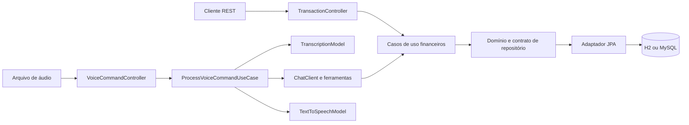

# Budgeting Voice — API de gastos com Spring AI

API de estudo que recebe um áudio em português, transcreve o comando, usa ferramentas de IA para registrar ou consultar gastos e devolve uma resposta em MP3.

Inclui um **frontend responsivo integrado ao Spring Boot**, feito em HTML, CSS e JavaScript, sem dependências externas no navegador. O mesmo JAR entrega a interface e a API.

## Experimente em dois minutos, sem chave de IA

Com JDK 17 instalado, execute:

```powershell
.\gradlew.bat bootRun --args='--spring.profiles.active=demo'
```

No Linux/macOS: `bash gradlew bootRun --args='--spring.profiles.active=demo'`.

**Abra [http://localhost:8080](http://localhost:8080) no navegador** para utilizar o painel. Não é necessário instalar Node.js para usar a aplicação.

## Interface web

- Painel com total de gastos, quantidade de transações e maior categoria.
- Gráfico de distribuição e totais por categoria, alimentados pela API real.
- Cadastro em formulário modal com máscara monetária: digite somente números, por exemplo `48122`, para exibir `481,22`. A vírgula, os centavos e os separadores de milhares são automáticos. Valores colados já formatados também são aceitos.
- Ações **Editar** e **Excluir** em cada linha: altere descrição, valor, categoria e data, ou confirme a remoção do lançamento. Os totais são recalculados após a operação.
- Tabela com filtro por categoria e paginação de cinco registros.
- Upload de áudio e player da resposta MP3 quando o processamento de IA estiver habilitado.
- Aviso explícito de modo demo, estados de carregamento, mensagens de erro e indicador de saúde da API.

No painel, clique em **Novo gasto**, informe descrição, valor e categoria e salve. O resumo e a tabela são atualizados automaticamente. Na seção de voz, selecione um áudio e clique em **Enviar comando**. No perfil demo, esse envio fica desativado; utilize o perfil padrão com uma chave válida para IA.

O painel abre no mês atual. O gráfico, os totais e a tabela consideram o mês selecionado, conforme a data de cada gasto. O filtro de categoria afeta apenas a tabela. No modo mensal, os registros são ordenados pela data mais recente e depois pelo UUID. Todos os períodos inclui os registros antigos sem data, que podem ser editados para informar a data correta.

As categorias exibidas são **Alimentação** (mercado, refeições e delivery), **Saúde** (medicamentos, consultas e exames) e **Locomoção** (combustível, transporte público e aplicativos). Os códigos da API continuam `GROCERIES`, `PHARMA` e `AUTO`, respectivamente, preservando os registros existentes. A IA utiliza essa mesma classificação.

Os arquivos estão em `src/main/resources/static/`: `index.html`, `styles.css`, `app.js` e `money.mjs`. O endpoint `/api/config` publica somente os sinalizadores de modo demo e disponibilidade do fluxo de IA, sem expor credenciais. Sua chave continua no servidor.

### Testes do frontend

Os testes de conversão monetária usam apenas o test runner nativo do Node.js 22:

```powershell
node --test src/test/frontend/money.test.mjs
```

Eles também são executados pela CI. Node.js é necessário somente para executar esses testes, não para servir a interface. O áudio real não foi testado com o provedor. No navegador foram conferidos cadastro, validação de valor zero, atualização dos totais, filtro e navegação entre páginas.

Em outro terminal:

```powershell
Invoke-RestMethod 'http://localhost:8080/transactions?page=0&size=2'
Invoke-RestMethod http://localhost:8080/transactions/GROCERIES/summary
Invoke-RestMethod http://localhost:8080/actuator/health
```

O perfil `demo` cria quatro gastos fictícios em memória, com total de mercado de R$ 210,40. Os dados são descartados ao parar a aplicação. Os modelos de IA e o endpoint de áudio ficam desativados nesse perfil. Para usar áudio real, execute no perfil padrão com sua chave conforme as instruções abaixo. Use Ctrl+C para encerrar um modo antes de iniciar o outro.

## Evidências técnicas para avaliação

| Decisão | Onde verificar |
| --- | --- |
| Casos de uso compartilhados entre REST e ferramentas de IA | `application/` e `ProcessVoiceCommandUseCase` |
| Regras de domínio e dinheiro em centavos | `Transaction`, testes de validação e de soma além do limite de long |
| Paginação feita no banco, filtro opcional e limite de 100 itens | `ListTransactionsUseCase` e `JpaTransactionRepository` |
| Falhas de IA com etapa identificada e aviso sobre efeitos parciais | `ApiExceptionHandler` e testes HTTP |
| Testes sem chamadas pagas e cobertura JaCoCo | `gradlew check` e relatórios em `build/reports/` |
| Build automatizado no GitHub | `.github/workflows/ci.yml` |
| Imagem em duas etapas com processo sem root | `Dockerfile` |
| Contrato da API e exemplos de requisições | `/openapi.yaml` e [docs/requests.http](docs/requests.http) |

As decisões e seus limites estão em [docs/architecture.md](docs/architecture.md). A CI está preparada para executar após publicar o repositório; não foi executada no GitHub nesta entrega. O Dockerfile não foi executado localmente porque Docker não está disponível neste ambiente.

Verificação local: **14 testes passaram**, o JAR foi gerado e os endpoints do modo demo foram conferidos no processo empacotado. Evidências e limites em [docs/verification.md](docs/verification.md).

Base: [módulo Spring AI da trilha DIO](https://github.com/digitalinnovationone/dio-spring-boot-learning-track/tree/main/05-spring-ai), de digitalinnovationone/Poiani, commit `9add4345f9f0f75e1a02dcd557c627fdf6187ff7`. Esta versão mantém as camadas do módulo e acrescenta a evolução descrita abaixo. Não é um fork publicado.

## Melhoria implementada

Consulta de resumo por categoria, disponível no endpoint `GET /transactions/{category}/summary` e na ferramenta `summarize-category` registrada no ChatClient. O resultado inclui a quantidade de transações, o total em centavos e o total em reais. Uma categoria sem gastos retorna zero.

Também foram adicionadas validações no domínio, usadas tanto pelo REST quanto pelo Tool Calling: descrição obrigatória de até 255 caracteres, valor positivo em centavos e categoria obrigatória. Dados inválidos no REST retornam HTTP 400 com ProblemDetail. Valores individuais usam `long` e totais usam `BigDecimal`, evitando perda de precisão monetária e overflow na soma.

## Tecnologias e organização

- Java 17, Gradle Wrapper 9.4.1 e Spring Boot 4.0.5.
- Spring AI 2.0.0-M4, ChatClient, ferramentas com `@Tool` e integração OpenAI.
- Spring Web, Spring Data JPA, H2 local, driver MySQL opcional e Lombok.
- JUnit 5, Mockito e AssertJ.

As versões de Spring Boot e Spring AI foram mantidas do módulo de referência; o Java foi ajustado para 17 e verificado nesta versão. Spring AI está em versão milestone.

`domain` contém regras e contrato de persistência; `application` contém casos de uso; `infrastructure` contém REST e adaptadores JPA. O resumo usa o mesmo caso de uso no REST e na IA.



Fluxo: áudio → TranscriptionModel → ChatClient → ferramenta → caso de uso → JPA → resposta textual → TextToSpeechModel → MP3.

## Como executar

Requisitos: JDK 17 e internet para baixar dependências. O Wrapper dispensa instalar Gradle. O fluxo de IA exige chave OpenAI com acesso aos modelos configurados e saldo; chamadas podem gerar custos.

No PowerShell, na pasta do projeto:

```powershell
$env:OPENAI_API_KEY = 'sua-chave'
.\gradlew.bat bootRun
```

No Linux/macOS:

```bash
export OPENAI_API_KEY='sua-chave'
bash gradlew bootRun
```

A API fica em `http://localhost:8080`. Os dados são persistidos em `data/`, ignorado pelo Git. Não é necessário Docker para o modo padrão. Para exercitar somente REST, uma chave fictícia permite inicializar (`$env:OPENAI_API_KEY = 'local-only'`); o áudio precisa de credencial real.

Os modelos estão em `src/main/resources/application.properties`. Não coloque sua chave nesse arquivo nem no Git. O arquivo `.env` não é carregado automaticamente pelo Spring.

### MySQL opcional

O `compose.yml` original foi preservado. Após iniciar `docker compose up -d`, configure `SPRING_DATASOURCE_URL`, `SPRING_DATASOURCE_USERNAME` e `SPRING_DATASOURCE_PASSWORD` conforme o compose antes de executar a aplicação. Esse modo não foi validado nesta entrega.

## Como testar via REST

`amount` representa **centavos** tanto nas requisições quanto nas respostas de transação: `1250` significa R$ 12,50. Categorias aceitas: `GROCERIES`, `PHARMA`, `AUTO`, `LEISURE`, `UNEXPECTED`. Esta API registra gastos; receitas e saldo não estão implementados.

PowerShell:

```powershell
$body = @{ description = 'Compra no mercado'; category = 'GROCERIES'; amount = 1250 } | ConvertTo-Json
Invoke-RestMethod -Method Post -Uri http://localhost:8080/transactions -ContentType 'application/json' -Body $body
Invoke-RestMethod http://localhost:8080/transactions/GROCERIES
Invoke-RestMethod http://localhost:8080/transactions/GROCERIES/summary
```

Para novas integrações, prefira a listagem paginada:

```powershell
Invoke-RestMethod 'http://localhost:8080/transactions?category=GROCERIES&page=0&size=10'
```

O filtro de categoria é opcional; `page` começa em zero e `size` aceita 1 a 100 (padrão 20). A resposta contém `items`, `page`, `size`, `totalElements` e `totalPages`. A ordenação é crescente por UUID, não por data. O endpoint antigo por categoria permanece disponível por compatibilidade.

Valores fracionários em `amount`, como `12.50`, retornam 400: informe `1250` para representar R$ 12,50.

Em banco vazio, após essa criação, o resumo será:

```json
{"category":"GROCERIES","count":1,"totalInCents":1250,"totalInReais":12.50}
```

Para validar a rejeição, envie `amount = 0`, uma descrição vazia ou uma categoria desconhecida. A resposta deve ser HTTP 400, sem salvar a transação.

### Fluxo com áudio

**Atalho para testar:** dê dois cliques em `Testar audio.cmd` na pasta do projeto. Ele pede a chave com digitação oculta e abre o navegador automaticamente, sem exigir comandos manuais. Veja [o passo a passo](docs/testar-audio.md). O teste fica separado da prévia demo e as chamadas à API podem gerar custos.

Grave um arquivo dizendo “Gastei doze reais e cinquenta no mercado”. Envie-o usando `curl.exe` no Windows (`curl` no Linux/macOS):

```powershell
curl.exe --fail-with-body -X POST http://localhost:8080/transactions/ai -F "file=@comando.m4a" --output audio-resposta.mp3
```

Abra o MP3 e consulte `/transactions/GROCERIES` para conferir o registro. Grave depois “Quanto gastei no mercado?” e repita o envio: a IA pode consultar a nova ferramenta de resumo. Há gravações de exemplo herdadas em `src/test/resources/audio/`. Use formatos suportados pelo provedor, como WAV, MP3 ou M4A, até 10 MB. Arquivo vazio retorna 400; excesso de tamanho retorna 413.

O envio de áudio compartilha conteúdo e contexto financeiro com o provedor. Cada requisição é independente, sem memória de conversa. Reenviar um comando de criação pode duplicar um gasto: ainda não há idempotência. Se a síntese de voz falhar após o registro, confira a listagem antes de repetir.

Falhas do fluxo de IA retornam HTTP 502 com `stage` igual a `transcription`, `interpretation` ou `speech`, sem expor mensagens internas do provedor. Isso não significa que a transação foi desfeita. Uma transcrição sem texto útil retorna 400.

## Contrato e operação

O contrato OpenAPI está disponível em [http://localhost:8080/openapi.yaml](http://localhost:8080/openapi.yaml) quando a aplicação está em execução. Ele é mantido como arquivo estático e pode ser importado no Postman. Exemplos prontos estão em [docs/requests.http](docs/requests.http), compatível com clientes HTTP de IDEs.

`GET /actuator/health` retorna a saúde da aplicação e do banco. Não testa o provedor de IA. Detalhes internos de saúde não são expostos.

Para construir e executar a imagem no modo demo:

```bash
docker build -t budgeting-voice .
docker run --rm -p 8080:8080 -e SPRING_PROFILES_ACTIVE=demo budgeting-voice
```

O container final roda sem root. O modo demo usa banco efêmero; persistência em container no perfil padrão exige configurar volume ou banco externo.

## Testes automatizados

```powershell
.\gradlew.bat check
.\gradlew.bat bootJar
```

A suíte padrão não chama a OpenAI e usa H2 em memória. Cobre criação e consulta via HTTP, resumo com isolamento entre categorias, categoria vazia, rejeições sem persistência, validação compartilhada com ferramentas e orquestração de áudio com modelos simulados. O teste de áudio verifica o encadeamento e o retorno binário; não comprova a interpretação de linguagem natural pelo provedor.

A suíte também cobre paginação sem repetição entre páginas, filtros, valores fracionários, áudio vazio sem chamada externa, falhas de transcrição/síntese sem vazamento de detalhes e inicialização demo com chave vazia e sem modelos. Um teste de resumo valida soma superior ao limite de `long`.

JaCoCo gera cobertura HTML em `build/reports/jacoco/test/html/index.html` e XML para ferramentas de análise. Não há meta artificial de cobertura. A CI executa `check bootJar` no Java 17 e publica relatórios e JAR como artifacts, sem credencial OpenAI.

Relatório: `build/reports/tests/test/index.html`. JAR executável: `build/libs/budgeting-0.0.1-SNAPSHOT.jar`.

Os exemplos externos originais (`*IT`) ficam fora da suíte padrão. Para executá-los deliberadamente com credencial real:

```powershell
$env:OPENAI_API_KEY = 'sua-chave'
.\gradlew.bat integrationTest
```

Sem a variável de ambiente, esses exemplos são ignorados. Eles dependem de rede, disponibilidade do provedor e respostas probabilísticas; podem gerar custos. A validação real com OpenAI não foi executada nesta entrega.

## Roteiro de aprendizado

Use os pontos abaixo para revisar o código e escrever seu próprio relato após experimentar:

1. Como o ChatClient descobre os métodos anotados com `@Tool`?
2. Por que validar no domínio protege também chamadas originadas pela IA?
3. Por que representar dinheiro com inteiros em centavos e BigDecimal?
4. Como o mesmo caso de uso atende REST e Tool Calling?
5. Qual é a diferença entre testar o fluxo com mocks e testar o provedor real?

Anote aqui o que você aprendeu, dificuldades encontradas e resultados dos seus próprios testes. Esse relato deve refletir sua experiência; não foi preenchido como se você já tivesse realizado os experimentos.

## Limites e próximos passos

Projeto educacional local, sem autenticação, isolamento de usuários ou auditoria persistente. A nova listagem é paginada; a listagem legada e o resumo ainda carregam os gastos da categoria em memória. O prompt orienta a IA, mas as regras determinísticas ficam no domínio. Próximas evoluções possíveis: idempotência, filtros por período, migrações de banco e confirmação antes de salvar. Veja os trade-offs em [docs/architecture.md](docs/architecture.md).

Para entregar na DIO, revise o código e o relato, crie seu repositório no GitHub e envie o link. Nenhum repositório remoto foi criado automaticamente.

### Categorias adicionais

- **Lazer** (LEISURE): saídas, hobbies, entretenimento e compras por diversão.
- **Imprevistos** (UNEXPECTED): despesas inesperadas, emergências e reparos urgentes. Essa categoria é escolhida quando o contexto indica um gasto imprevisto, sem presumir que toda despesa de saúde ou manutenção seja emergencial.

As duas opções estão disponíveis no cadastro, filtros, gráfico, resumo REST e ferramentas de IA.


### Período mensal e data do gasto

O campo `date` usa o formato `AAAA-MM-DD`. No frontend ele é obrigatório e começa com a data atual de São Paulo. Na API, um cadastro sem `date` usa a data atual; uma edição sem `date` preserva a data existente, por compatibilidade.

Exemplos: `GET /transactions?month=2026-10` e `GET /transactions/LEISURE/summary?month=2026-10`. O intervalo vai do primeiro dia do mês, inclusive, ao primeiro dia do próximo mês, exclusivo. Sem `month`, os endpoints retornam todos os períodos. Datas e meses inválidos retornam 400.

Se a data for alterada para outro mês, o gasto deixa de compor o mês anterior. A interface passa a mostrar o mês do lançamento salvo. Registros persistidos antes da adição desse campo podem estar sem data e não entram no gráfico mensal até que ela seja informada. Eles permanecem acessíveis em Todos os períodos. O uso de `ddl-auto=update` adiciona a coluna no banco local; em produção isso deve ser substituído por uma migração versionada.


### Testar sem pagar pela API

Use `Testar gratis.cmd` ou a configuração **Budgeting — Gratuito (sem OpenAI)** do VS Code. Abra `http://localhost:18083/#voice`: dite ou digite um gasto, revise os campos e confirme em **Salvar gasto**. Este modo usa o ditado do navegador e regras locais para preencher o formulário, sem chamadas à OpenAI. Os dados são persistidos em H2 (`data/budgeting-free`). O ditado depende de suporte do navegador e pode exigir internet. Veja os detalhes e limitações em [docs/testar-audio.md](docs/testar-audio.md).
